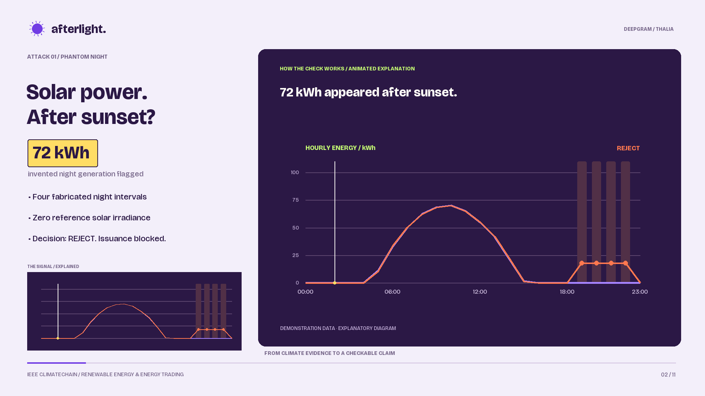
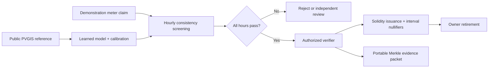

# AFTERLIGHT

**Every clean kilowatt needs an alibi.**

An energy evidence desk that screens solar generation claims against weather, commits the evidence to Ethereum, and refuses to issue the same registered asset-hour twice.

Built for the **IEEE ClimateChain Global Hackathon — Renewable Energy & Energy Trading** track. The memorable demo is an attack: invent solar generation after sunset, inflate a daytime peak, shift a meter clock, then try to reuse a clean claim's intervals.



[Try the live app](https://afterlight-3ch7.onrender.com/) · [Watch on YouTube](https://youtu.be/JrWJmzfMmjQ) · [Download the 4:34 motion demo](artifacts/afterlight-demo.mp4) · [Deployment guide](docs/DEPLOY.md) · [Devpost copy](docs/SUBMISSION.md) · [Technical design](docs/TECHNICAL.md)

## Deploy

The [live Render app](https://afterlight-3ch7.onrender.com/) was verified on 25 October 2026 through the complete screening, issuance, replay, tamper, retirement and export workflow; results are in [verification.json](artifacts/verification.json). Each visitor gets a separate temporary demo EVM, with no API keys or wallet setup. To deploy another instance, push the repository to GitHub and use **Render → New → Blueprint** with the included `render.yaml`. See [the deployment guide](docs/DEPLOY.md) for exact settings and checks.

## Brand and thumbnail

The original **Sun Receipt** logo and matching YouTube thumbnail are included in [the media kit](artifacts/afterlight-media-kit.zip). Use [the outlined SVG](artifacts/brand/afterlight-logo-primary.svg), [transparent PNG](artifacts/brand/afterlight-logo-primary.png), or [thumbnail JPEG](artifacts/thumbnail/afterlight-youtube.jpg). See [brand guidance](docs/BRAND.md) and the [imagegen prompt](docs/THUMBNAIL-PROMPT.md).

## Devpost upload packet

[Field-by-field answers](docs/DEVPOST-FIELDS.md), the [seven-section project story](docs/DEVPOST-ABOUT.md), a [3:2 thumbnail](artifacts/devpost/afterlight-devpost-thumbnail.png), and a [complete submission ZIP](artifacts/Afterlight-IEEE-Submission.zip) are ready for the project owner to upload. The ZIP includes runnable source, reference data, verification evidence, seven gallery images and the demo film; API keys and local chain state are excluded. `artifacts/devpost/package-verification.json` records the archive size, checksum and integrity checks. Rebuild the packet with `python3 scripts/package-devpost.py` (requires Pillow). Prepared files are not a Devpost submission receipt.

## Run

Node.js 22 or newer; no API key, external wallet, RPC service, or ongoing internet connection required after dependency installation. The public reference snapshot is included.

```sh
npm ci
npm run build
npm start
```

Open **http://127.0.0.1:4173**. Choose **Try to break it** for the guided sequence. The app binds to loopback because it controls local demonstration signers.

```sh
npm test                    # model, adversarial scenarios, contract permissions and persistence
npm run demo:verify         # complete HTTP + EVM workflow; server must be running
npm run train               # reproduce the committed model
npm run evidence:verify -- path/to/exported-evidence.json
```

The verification script intentionally issues and retires a demonstration certificate. To start another fresh presentation, stop the server and run:

```sh
npm run demo:reset
npm start
```

The reset command **archives** the prior `.data` session under `.sessions/`, including its chain and reports. It refuses to reset a running server. Local state and demonstration accounts are excluded from Git.

## What works

- Four case files, an interactive hourly chart, evidence table, and source fingerprints.
- Import any 24 whole-number hourly Wh readings for the fixed demonstration asset/date.
- Real ridge-regression training, chronological calibration/test splits, and inspectable uncertainty intervals.
- PASS / REVIEW / REJECT decisions; reviewed and rejected claims cannot be issued through the verifier.
- Compiled Solidity on Ganache, accessed with ethers: persistent locally, or isolated per visitor in hosted demo mode.
- Verifier-only issuance; immutable asset registration; capacity checks; 24 asset-hour nullifiers; permanent owner-authorized retirement.
- SHA-256 Merkle receipts that bind source/model fingerprints, policy, asset/day and all readings.
- Duplicate challenge with a **changed evidence root**, evaluated directly by the EVM rather than the interface's duplicate check.
- Downloadable evidence and offline integrity verification.
- An original solar-punk interface: violet, coral and acid lime; a clickable 24-hour solar alibi dial; linked hourly evidence; colorful case files; and a guided walkthrough. The application has no paid runtime dependency.

## Regenerate the Deepgram narration

The delivered 4:34 motion film uses **Deepgram Aura-2 Thalia**, 48 kHz speech, kinetic typography, animated solar traces, interval locks, Merkle-tree propagation, and matched-color chapter wipes. Each explanatory graphic resolves into an actual UI capture. An original 96 BPM ambient-electronic score ducks beneath the voice; stereo audio and English subtitles are included. The generator reads the key into memory from an environment file; it never copies it into the project or browser. Public narration provenance is in `artifacts/narration-provenance.json`.

```sh
npm run demo:narrate -- --env-file /absolute/path/to/your/.env
python3 scripts/make-demo.py
```

The environment file should contain `DEEPGRAM_API_KEY`, `DEEPGRAM_KEY`, or `DEEPGRAM_API`. The renderer needs NumPy, Pillow, ffmpeg and ffprobe; the display font is bundled under its open font license. Completed narration clips and render intermediates are cached outside version control. `scripts/motion_demo.py` renders the film; `scripts/score.py` synthesizes the original music without third-party recordings or samples. `artifacts/music-provenance.json`, `artifacts/audio-verification.json`, and `artifacts/motion-verification.json` document the score and media checks. Regeneration sends only the demonstration narration text to Deepgram and uses that account's TTS allowance.

## Demonstrated results

| Claim | Result | Flagged hours | Meaning |
|---|---|---:|---|
| Clean reference-derived production | PASS | 0 | 481.064 kWh passes the demo screening policy |
| Phantom night | REJECT | 4 | 72 kWh inserted after sunset is flagged |
| Inflated peak, +35% in six hours | REVIEW | 6 | Below installed capacity, but inconsistent with the model envelope |
| Clock shifted by four hours | REJECT | 15 | The daily sum is unchanged; hourly alignment exposes the problem |
| Second issuance with another root | EVM revert | — | `DuplicateInterval(0)` prevents reusing reserved asset-hours |
| +1 kWh edit to an evidence reading | Integrity mismatch | — | The packet no longer matches its committed root |

`artifacts/verification.json` records the end-to-end checks, transaction hash, block, gas use, and evidence root. The test suite includes reopening a persistent chain and checking that retirement and nullifiers remain intact.

## The AI, precisely

The input is a real public **European Commission JRC PVGIS 5.3** download: 8,760 hourly records for İzmir in 2023, SARAH3 irradiance, ERA5 weather, a configured 100 kWp c-Si system, 30° south tilt, and 14% losses. **PVGIS power is modeled, not measured meter telemetry.** The cooperative and demonstration meter claims are illustrative.

The model learns PVGIS output from irradiance, nonlinear irradiance terms, and temperature/wind interactions. Training uses January–June daylight records; July–September residuals calibrate a nominal 90% split-conformal interval; October–December is held out. The displayed demonstration date, 15 October, is in that test period.

The claim boundary is PV generation at the inverter, excluding battery discharge. The demo registry imposes a 100 kW export limit separately from the 100 kWp reference array size; nameplate DC capacity alone is not a universal physical bound on PV output. A site with storage or a different settlement boundary requires a different policy and authenticated telemetry.

| Held-out metric | Value |
|---|---:|
| Test hours | 2,208 |
| Daylight test hours | 902 |
| Daylight mean absolute error | 0.306 kW |
| Daylight empirical interval coverage | 94.1% |
| Daylight interval radius | ±0.775 kW |

These measure a **surrogate of modeled power at one site/year**, not real-meter fraud accuracy. Chronological data are not necessarily exchangeable, so nominal conformal coverage is not a guarantee under distribution shift. The screening adds a 3 kWh operational margin and abstains when source irradiance is reconstructed. Nighttime and registered-capacity checks are explicit rules, not presented as learned discoveries.

PVGIS timestamps are preserved at `:10 UTC`. The demo maps each sample into its containing hour and approximates energy as `P(W) × 1 h / 1000`. That is not a revenue-grade settlement method.

## Trust boundaries



The ledger prevents duplicate issuance **inside this registry for the same registered identity and intervals**. It does not identify duplicate physical installations registered under different identities or stop issuance in unrelated registries. Asset identity, authentic meters, and verifier honesty remain off-chain trust requirements. The contract accepts only its authorized verifier, but that signer can bypass the off-chain model: on-chain policy enforcement is deliberately limited and documented.

A Merkle root proves integrity relative to an anchored root, not the truth of its inputs. A forged claim can have an intact packet. Passing weather screening is supporting evidence, not proof of generation, accreditation, additionality, or avoided emissions. No carbon reductions or real-world pilot results are claimed.

The EVM uses public deterministic development accounts. Do not fund them or treat these certificates as accredited RECs. Local mode stays loopback-only; public hosting uses the explicitly isolated `hosted-demo` mode described in [DEPLOY.md](docs/DEPLOY.md). A production registry needs independent asset/meter authentication, governance and oracle signers, real-site validation, interoperability and a security audit. The native µWS optional accelerator may fall back to JavaScript on newer Node builds; the tested ledger workflow still functions.

## Repository

```text
contracts/Afterlight.sol        Registry, nullifiers and retirement
lib/model.mjs                  Ridge fitting and conformal calibration
lib/engine.mjs                 Screening policy and Merkle evidence
lib/ledger.mjs                 EVM and certificate adapter
lib/contract-artifact.mjs      Build-time Solidity compiler and source-hash check
lib/http.mjs                   Local and hosted HTTP API
lib/sessions.mjs               Isolated, expiring hosted demo chains
server.mjs                     Server entry point and deployment settings
render.yaml                    Render web-service Blueprint
public/                        Responsive verification workspace
data/                          Public reference snapshot and trained model
scripts/                       Reproduction, integrity checks and demo tools
test/                          Meaningful model, contract and persistence checks
docs/                          Devpost copy, demo script and technical design
artifacts/                     Demo video, actual UI captures and verification evidence
```

## Sources and attribution

- [Deepgram Aura text-to-speech REST API](https://developers.deepgram.com/reference/text-to-speech/speak-request).
- Display typography: Bricolage Grotesque, bundled with its SIL Open Font License in `public/fonts/OFL.txt`.
- [Official hackathon rules and judging criteria](https://ieee-climatechain-hack.devpost.com/rules).
- [European Commission JRC — PVGIS API](https://joint-research-centre.ec.europa.eu/photovoltaic-geographical-information-system-pvgis/using-pvgis-5/api-non-interactive-service_en).
- [European Commission JRC — hourly radiation and modeled PV power](https://joint-research-centre.ec.europa.eu/photovoltaic-geographical-information-system-pvgis/using-pvgis-5/pvgis-5-tools/hourly-radiation_en).
- Exact source request is recorded in the application, `scripts/fetch-data.mjs`, and exported evidence. Refresh with `npm run data:fetch`, retrain, and rerun checks.

Project code is MIT licensed. Public-source data and third-party dependencies retain their own rights and terms. The UI illustration is an original vector drawing, not a satellite photograph. Built with AI-assisted coding and Deepgram Aura-2 Thalia narration for the demo; all reported checks were executed.
